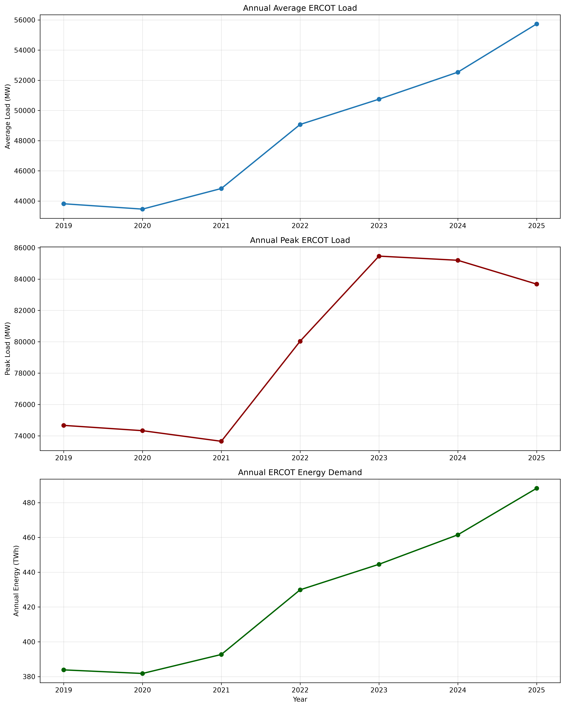
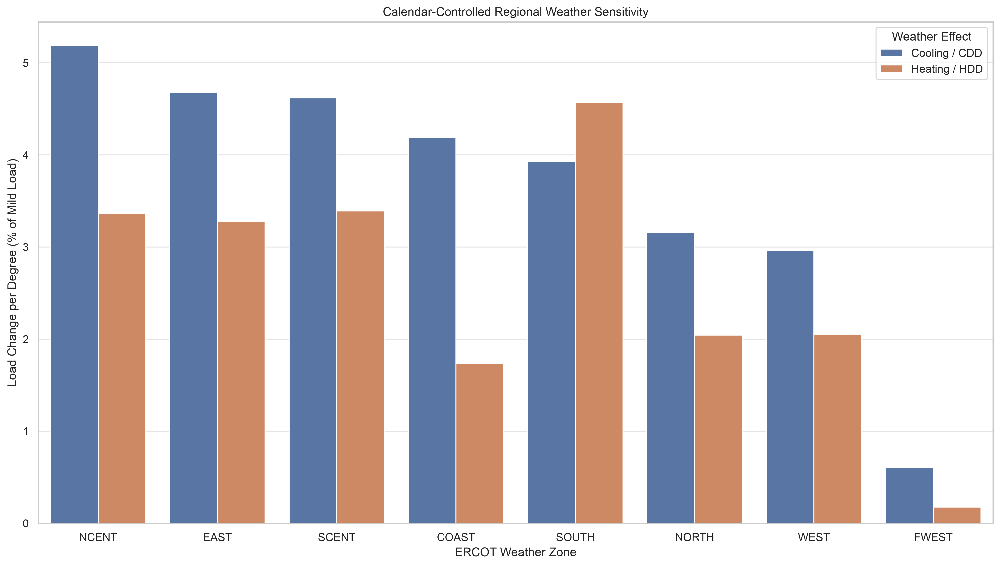
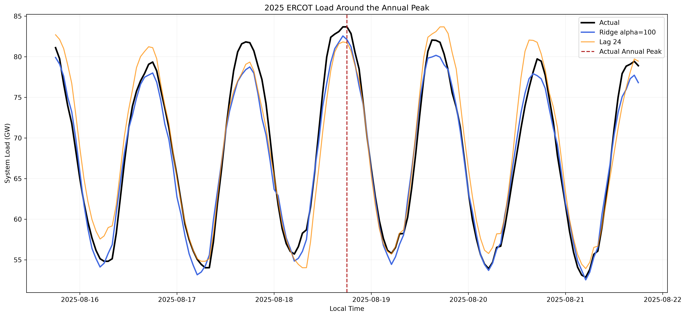
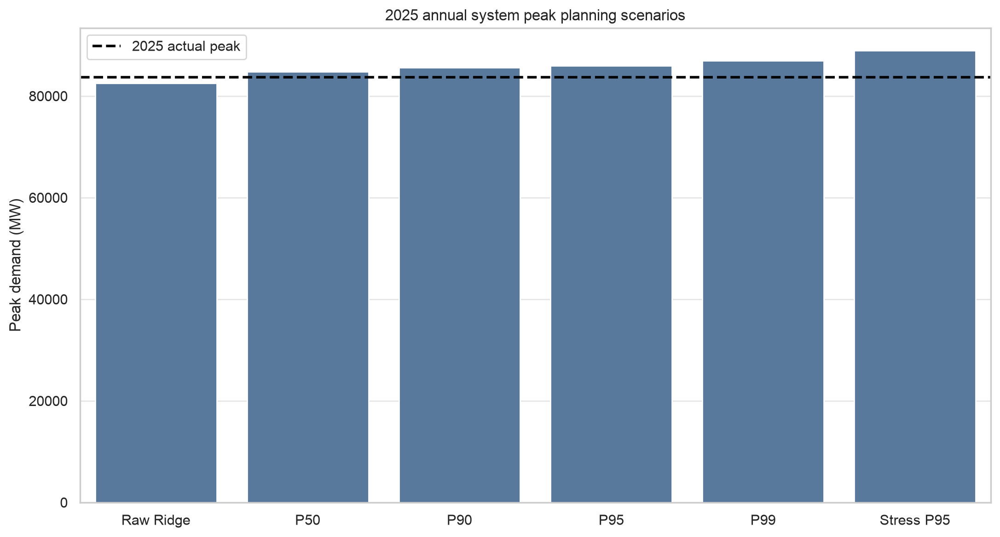
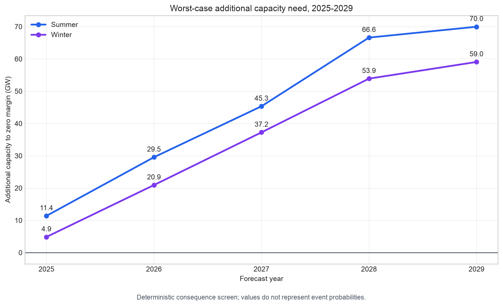

# ERCOT-Energy-Demand-Forecasting-and-Capacity-Planning
ERCOT electricity demand forecasting, peak-demand uncertainty quantification, and capacity adequacy analysis using Python and machine learning.

An ERCOT case study connecting hourly load forecasting, peak-demand uncertainty, and seasonal capacity adequacy scenarios using 2019–2025 load and weather data.


## Overview

Capacity planning depends on both expected demand and the risk of unusually high demand. This project prepares hourly ERCOT load and weather data, evaluates regional forecasting models, estimates conditional peak-demand distributions, and compares those demand scenarios with a fixed vintage of official planning capacity.

The analysis addresses three questions:

1. How well can regional and system hourly load be predicted in a historical test year?
2. How does high-load forecast bias affect peak-demand planning scenarios?
3. Under specified demand-growth and supply assumptions, when does planning capacity fall below demand or a reserve-margin benchmark?

## Key Results

| Measure | Archived result |
|---|---|
| Historical load coverage | 61,368 hourly records, 2019–2025 |
| Regional load–weather coverage | 490,944 zone-hour records across eight weather zones |
| Final hourly model | Eight regional Ridge models, alpha = 100 |
| 2025 system WAPE | 3.258%, compared with 4.519% for lag 24 |
| Relative WAPE reduction | Approximately 27.9% |
| 2025 actual annual peak | 83.679 GW |
| Raw Ridge annual forecast peak | 82.562 GW |
| Daily-block bootstrap peak P50 / P90 / P95 | 84.783 / 85.646 / 85.938 GW |
| Seasonal baseline combinations | 90 |
| Supply-scenario combinations, including baseline | 540 |
| Saved final capacity QA | 15 of 15 final checks passed; 17 of 17 registered QA groups passed |

These forecasting results use realized weather and observed historical lag inputs in a chronological pseudo-out-of-sample evaluation. The bootstrap quantiles are conditional, model-implied peak scenarios.

Under the project's 2025 P95 baseline demand case, planning capacity exceeds demand by approximately 17.167 GW in summer and 19.353 GW in winter. Under the specified compound supply stress, the maximum modeled direct deficits are approximately 11.383 GW and 4.853 GW, respectively. These figures describe the consequences of deterministic assumptions.

The 90 baseline combinations cover five planning years, two seasons, three growth paths, and three demand quantiles. Applying six supply scenarios produces 540 combinations; this set includes the unchanged-supply baseline.

## Selected Figures

### 1. Historical ERCOT Load Trends (2019–2025)



Annual average load, peak demand, and total electricity consumption across ERCOT from 2019 to 2025. Average demand and annual energy consumption increased substantially over the study period.

### 2. Regional Weather Sensitivity



Calendar-controlled estimates of regional electricity load sensitivity to cooling degree days (CDD) and heating degree days (HDD), highlighting differences in weather-related demand patterns across eight ERCOT zones.

### 3. Hourly Load Forecasting Around the 2025 Annual Peak



Comparison of actual hourly load, Ridge regression predictions, and the Lag-24 baseline around the 2025 annual peak. Ridge improves overall forecasting accuracy but still underpredicts certain high-demand periods.

### 4. Peak-Demand Uncertainty Scenarios



Comparison of the raw Ridge peak prediction, daily-block Bootstrap peak-demand quantiles, and an independent-hour stress scenario. The simulated P50, P90, and P95 annual peak estimates support risk-aware capacity planning.

### 5. Worst-Case Capacity Requirements (2025–2029)



Modeled additional capacity requirements under the specified compound supply-stress and demand-growth assumptions. These deterministic worst-case scenarios illustrate potential capacity risks and do not represent expected outcomes or event probabilities.

## Workflow

```text
01  Inspect and clean hourly load
02  Analyze trends, seasonality, regions, and high-load events
03  Acquire and align regional ERA5 weather
04  Analyze weather sensitivity and prepare features
05  Compare hourly forecasting models with chronological validation
06  Calibrate residuals and simulate conditional peak uncertainty
07  Compare demand scenarios with seasonal planning capacity
```

## Data

| Source | Scope | Use |
|---|---|---|
| ERCOT historical hourly load | 2019–2025; system and eight weather zones | Load analysis, forecasting targets, and lag features |
| Open-Meteo Historical Weather API, ERA5 | Hourly weather at representative regional locations | Weather alignment, CDD/HDD, and sensitivity analysis |
| ERCOT December 2024 Revised CDR | Planning years 2025–2029 | Seasonal capacity, resource composition, ELCC, and supply scenarios |

Load records retain their original Hour Ending labels alongside a continuous UTC key. The project flags 48 hours in 2021 where the reported system total differs from the sum of the weather-zone loads. The records are preserved, with exclusions and inherited lag-quality flags applied where appropriate.

The CDR file used is `CapacityDemandandReservesReport_December2024.xlsx`. This repository should preserve its source vintage and checksum when packaged. Capacity results are historical planning scenarios tied to that vintage.

## Forecasting and Evaluation

The project compares lag-24 and lag-168 baselines, Ridge regression, and HistGradientBoosting variants. Regional forecasts are summed to obtain the ERCOT system forecast.

Model selection uses chronological validation, including rolling evaluations for 2023 and 2024. The selected Ridge configuration is refitted on 2019–2024 data and evaluated on 2025. Metrics include MAE, RMSE, WAPE, bias, high-load performance, annual peak magnitude, and peak timing.

Ridge improves average hourly accuracy while retaining a high-load underprediction problem. This motivates the separate peak-uncertainty stage.

## Peak Uncertainty

The uncertainty stage uses 2023–2024 out-of-sample residuals to compare global, forecast-decile, and season-conditioned calibration methods. Hourly P50 calibration uses annual forecast-decile residual medians. Upper hourly bounds use the selected seasonal or annual decile rules.

For final peak planning, 5,000 daily-block bootstrap simulations sample residual days conditioned on season and daily forecast-peak quintile. This preserves within-day error dependence. Independent hourly resampling remains a conservative stress comparison.

Annual peak quantiles come from the distribution of simulated annual maxima. They differ from taking the maximum of an hourly quantile curve.

## Capacity Adequacy

The capacity stage extends 2025 demand quantiles through 2029 under low, base, and planning-stress growth paths. It compares summer and winter demand with the CDR's official seasonal planning capacity.

Core measures are:

```text
Capacity margin = Planning capacity − Peak demand
Reserve margin  = Capacity margin / Peak demand
Direct deficit  = max(Peak demand − Planning capacity, 0)
```

A 13.75% summer reserve-margin comparison benchmark is applied separately from the zero-margin test. Winter results report capacity and reserve margins without applying that summer target.

Supply scenarios include unchanged supply, a 15% aggregate non-IBR operational outage, 50% wind-and-solar effective-capacity derating, 50% BESS effective-capacity derating, 100% planned net project delay, and the compound case. Effective resource capacity is attributed within official total capacity to avoid adding ELCC contributions twice.

## Analysis Guide

| Notebook | Main output |
|---|---|
| `01_data_inspection.ipynb` | Cleaned hourly load and quality flags |
| `02_exploratory_analysis.ipynb` | Trends, regional structure, and high-load event summaries |
| `03_weather_data_preparation.ipynb` | Aligned regional load–weather data |
| `04_weather_impact_analysis.ipynb` | Weather sensitivity and modeling features |
| `05_load_forecasting.ipynb` | Model comparisons, predictions, and residual inputs |
| `06_peak_forecasting_and_uncertainty.ipynb` | Final annual, seasonal, monthly, and regional peak scenarios |
| `07_capacity_adequacy_and_gap_analysis.ipynb` | Continuous-year adequacy cases, stress cases, first-shortfall years, and QA |

All notebooks are under `notebooks/`. Reusable load-cleaning functions are under `src/cleaning/`. Figures and tables are under `report/`.

The final forecasting comparison is `report/tables/forecasting/test_2025_system_model_comparison.csv`.

Final peak-planning results are the `06_16_final_*_capacity_planning.csv` files under `report/tables/peak_uncertainty/`. The selected methodology is recorded in `06_19_final_methodology_summary.csv`.

Final capacity results use the `07_21_continuous_*` and `07_22_continuous_*` tables under `report/tables/capacity_adequacy/`. Earlier endpoint-stage outputs remain intermediate analyses.


## Limitations

- Realized weather supports a historical conditional evaluation; deployment requires weather forecasts available at the prediction origin and explicit lag-input availability.
- The peak scenarios use two years of validation residuals and a specified weather path. Nominal quantiles do not establish long-run empirical coverage.
- CDR capacity is a dated planning outlook. The analysis does not predict realized hourly generator output.
- Winter demand uses seasonal scaling; intermediate-year resource attribution uses documented calibration bridges.
- Supply shocks are deterministic sensitivity assumptions. The project does not estimate LOLE, EUE, or outage event probabilities.
- Regional allocation uses coincident system-peak shares and does not model transmission constraints or local deliverability.
- Market prices, bidding, storage dispatch, and trading returns are outside the completed scope.

## Possible Extensions

Candidate extensions include a DuckDB reporting layer, forecast-weather evaluation, probabilistic hourly resource adequacy, or a separate day-ahead/real-time spread study. Each should be added with its own data, evaluation design, and completed outputs.
